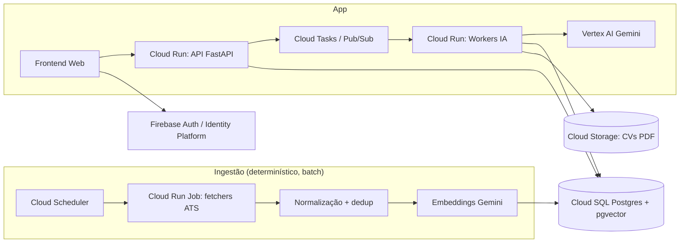
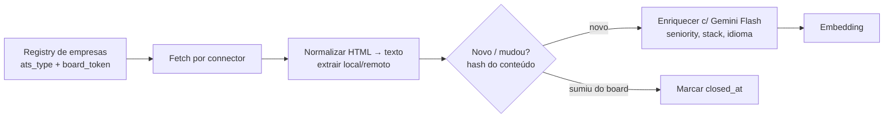
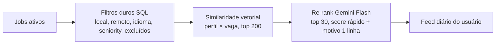
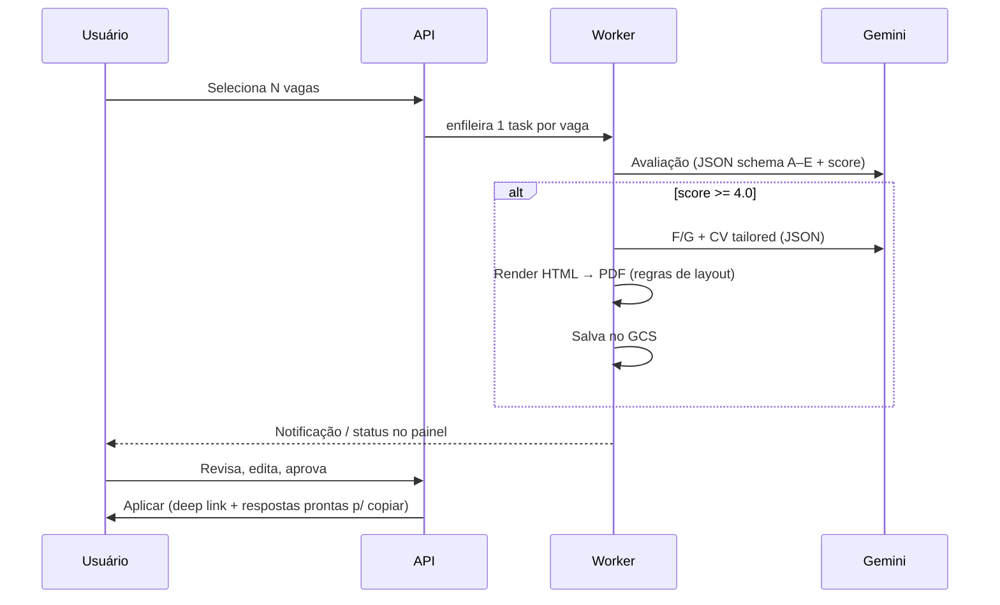

# Career-Ops Cloud — Proposta de Arquitetura (v0)

## 1. Visão geral

Hoje o projeto é **CLI + skills de agente** (prompts em `.agents/skills/*`) operando sobre arquivos locais (`profile.yml`, `cv.md`, `story-bank.md`, `workspace/*.md`). A migração consiste em:

1. Trocar **arquivos → banco de dados** (multi-usuário).
2. Trocar **agente interativo → workflows orquestrados** (determinísticos + chamadas Gemini com saída estruturada).
3. Trocar **CLI → Web app + API**.



---

## 2. Stack GCP sugerida

| Camada | Serviço | Por quê |
| :--- | :--- | :--- |
| API | **Cloud Run** (FastAPI, Python) | Reaproveita o código Python atual; escala a zero |
| Ingestão | **Cloud Run Jobs** + **Cloud Scheduler** | Batch periódico (ex.: a cada 6h), paralelizável por ATS/empresa |
| Fila / async | **Cloud Tasks** (por job de usuário) ou **Pub/Sub** | Avaliações e geração de CV são lentas (10–60s) → não bloquear request |
| Orquestração multi-step | **Cloud Workflows** (opcional) | Útil p/ Evaluate → CV → Prep encadeados com retry |
| Banco | **Cloud SQL Postgres + pgvector** | Relacional + busca vetorial no mesmo lugar; AlloyDB se crescer |
| Arquivos | **Cloud Storage** | CVs gerados, CVs enviados pelo usuário |
| IA | **Vertex AI Gemini** (Flash p/ volume, Pro p/ avaliação/CV) + **gemini-embedding** | Saída estruturada (JSON schema) substitui os "completion gates" dos skills |
| Auth | **Firebase Auth / Identity Platform** | Google login pronto |
| Segredos | **Secret Manager** | Chaves de API |
| Frontend | Next.js (Cloud Run ou Firebase Hosting) | — |

> [!TIP]
> Começar com **um único serviço Cloud Run** (API + workers no mesmo container, rotas diferentes acionadas por Cloud Tasks) reduz muito a complexidade no MVP.

---

## 3. Modelo de dados (simplificado)

```mermaid
erDiagram
    USER ||--|| PROFILE : has
    USER ||--o{ STORY : owns
    USER ||--o{ APPLICATION : tracks
    COMPANY ||--o{ JOB : posts
    JOB ||--o{ APPLICATION : targeted_by
    APPLICATION ||--o| EVALUATION : has
    APPLICATION ||--o{ GENERATED_CV : has
    APPLICATION ||--o| INTERVIEW_PREP : has
    PROFILE ||--o{ ARCHETYPE : defines

    COMPANY { uuid id; string name; string ats_type; string board_token; bool active }
    JOB { uuid id; string external_id; string title; text description; string location; string remote; string seniority; vector embedding; timestamp first_seen; timestamp closed_at }
    PROFILE { jsonb cv_structured; jsonb preferences; vector embedding }
    ARCHETYPE { string name; string headline; jsonb superpowers }
    STORY { string title; text situation; text task; text action; text result; text reflection; string[] tags }
    APPLICATION { string status; float match_score; timestamp applied_at }
    EVALUATION { float score; jsonb sections_a_to_g; string[] keywords; string language }
    GENERATED_CV { jsonb content; string gcs_path }
    INTERVIEW_PREP { jsonb specific_qs; jsonb general_qs; uuid[] story_ids }
```

Ponto-chave: **`JOB` é global (compartilhado entre usuários)**; tudo que é personalizado vive em `APPLICATION` e filhos. Isso faz o custo de ingestão não escalar com nº de usuários.

---

## 4. Workflows

### W0 — Ingestão de vagas (determinístico)



- Reaproveita direto [connectors.py](../src/career_ops/fetcher/connectors.py).
- **ATS com API pública de leitura:** Greenhouse, Lever, Ashby, Recruitee, SmartRecruiters, Workable (Breezy não traz JD completa no `/json`).
- **Problema principal = descoberta de empresas (board tokens).** As APIs exigem saber o token. Fontes: sitemap/busca por `boards.greenhouse.io/*`, `jobs.lever.co/*`, `jobs.ashbyhq.com/*`; listas comunitárias; e permitir que o usuário sugira empresas (o token vira global).
- Enriquecimento com LLM só em vagas **novas** (hash), barato com Flash.
- Remover `GoogleSearchConnector` do core (custo + qualidade de JD variável) — ou manter como fonte secundária.

### W1 — Onboarding do usuário (IA + formulário)

1. Upload do CV (PDF/DOCX) ou LinkedIn export → **Gemini extrai `cv_structured`** (JSON schema: experiências, bullets, skills, educação, idiomas).
2. Usuário revisa/edita no formulário (fonte da verdade = banco, não o PDF).
3. Preferências determinísticas: cargos-alvo, senioridade, local/remoto, faixa salarial, idiomas, empresas a excluir.
4. **Gemini gera arquétipos** (equivalente a `career-ops-archetypes`) → usuário aprova.
5. **Seed do banco de histórias**: Gemini propõe STAR+R a partir dos bullets; usuário completa via mini-entrevista guiada (chat).

### W2 — Recomendação (híbrido, sem LLM caro)



- Feedback do usuário (👍/👎/ocultar) alimenta o ranking depois.
- **Avaliação completa (A–G) só para vagas que o usuário marcar** → controla custo.

### W3 — Avaliar → CV → Aplicar



- O prompt do [career-ops-evaluate SKILL.md](../.agents/skills/career-ops-evaluate/SKILL.md) vira um **system prompt + response schema**; o "Completion Gate" vira validação Pydantic com retry.
- **Seção D (Comp & Market)** precisa de grounding: usar **Gemini com Google Search grounding**.
- CV: Gemini gera **JSON** (bullets selecionados/reescritos), renderização é **determinística** (template HTML + WeasyPrint/Playwright) — garante as regras de 1 página, margens, ordem de seções.

> [!WARNING]
> **Aplicação via API é praticamente inviável para terceiros.** Os endpoints de candidatura do Greenhouse (Job Board API `POST`), Lever (`POST /v0/postings/...?key=`) e Ashby (`applicationForm.submit`) exigem a **API key da empresa empregadora**. Só funcionariam com parceria com o empregador.
> Alternativas realistas: (1) deep link + respostas pré-geradas para copiar; (2) extensão de navegador que preenche o formulário do ATS (o usuário clica "enviar") — melhor custo/benefício; (3) automação headless — **evitar** (ToS, captcha, risco de banir o usuário).

### W4 — Preparação para entrevista

- **Perguntas específicas**: geradas da JD + avaliação + gaps (seção B).
- **Perguntas gerais**: banco curado (behavioral, por arquétipo/senioridade) — determinístico + personalização leve.
- **Banco de histórias**: CRUD + Gemini mapeia histórias → competências da vaga; detecta lacunas ("você não tem história de conflito com stakeholder").
- Extra (fase 2): **mock interview** com Gemini Live API (voz) e feedback.

---

## 5. Mapa de reaproveitamento do código atual

| Atual | Destino |
| :--- | :--- |
| `fetcher/connectors.py`, `orchestrator.py` | Job de ingestão (W0) — quase direto |
| `normalize.py`, `dedup.py` | Normalização/dedup na ingestão |
| `cv.py` | Renderizador de PDF (W3) |
| `.agents/skills/*/SKILL.md` | Prompts versionados (`prompts/`) + schemas Pydantic |
| `profile.yml`, `cv.md`, `story-bank.md` | Tabelas `PROFILE`, `ARCHETYPE`, `STORY` |
| `applications.md`, `job-tracker.csv`, `pipeline.md` | Tabela `APPLICATION` (status) |
| `scan_csv.py`, `merge_tracker.py`, `sync_check.py` | Descartados (substituídos pelo banco) |

---

## 6. Roadmap sugerido

| Fase | Escopo | Resultado |
| :--- | :--- | :--- |
| **0 — Fundação** | Monorepo, FastAPI, Postgres+pgvector, Cloud Run, Auth, CI/CD | Esqueleto deployado |
| **1 — Ingestão** | W0 com Greenhouse/Lever/Ashby + registry de ~500 empresas | Base de vagas atualizada |
| **2 — Single-user MVP** | W1 simplificado (importa seus dados atuais) + W2 + W3 sem aplicar | Substitui o uso local para você |
| **3 — Multi-usuário** | Onboarding completo, billing/quotas de IA, LGPD | Beta fechado |
| **4 — Prep + Apply assist** | W4 completo, extensão de navegador p/ preencher | Produto completo |

> [!IMPORTANT]
> **LGPD**: CVs são dados pessoais. Precisa de consentimento, exclusão de conta, região `southamerica-east1` e não usar dados de usuários para treino.

---

## 7. Decisões em aberto

1. **Público**: só você (ferramenta pessoal na nuvem) ou SaaS multiusuário? Muda auth, quotas, billing e LGPD.
2. **Mercado de vagas**: Brasil, global remoto ou ambos? (Greenhouse/Lever/Ashby são fortes em tech global; vagas BR estão muito em Gupy, que não tem API aberta.)
3. **Frontend**: Next.js? Ou algo mais simples para MVP (ex.: Streamlit/HTMX)?
4. **Apply assist**: vale investir em extensão de navegador?
